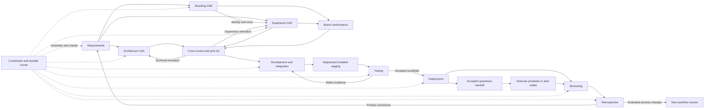

# Ten-agent delivery cycle — initial proposal

The [definition set](../README.md) now develops this concept. Use the
[operating contract](../contracts/operating-contract.md) for authoritative draft
statuses, gates, artifact contracts, and authority; this blueprint is context.

## Objective and scope

This project's primary deliverable is the definition of the ten agents themselves.
First specify each agent's mission, responsibilities, inputs, outputs, decision rules,
tools and permissions, handoffs, completion criteria, and failure behavior. Define
their shared architecture assumptions and coordination protocol alongside them.
Then use a pilot project to validate and refine the resulting agent system.
Application generation below describes the agents' eventual purpose, not the current
project's immediate deliverable.

Enable a product owner to describe an application precisely, then receive a working,
deployable application and evidence that it meets those requirements. The operator
must be able to see progress, unresolved decisions, release status, and reasons for
failure without reconstructing agent conversations.

Start with a deliberately bounded application family: authenticated, database-backed
web applications with forms, lists, detail pages, and explicit business workflows.
Native mobile, hard real-time systems, arbitrary infrastructure, and novel distributed
architectures are outside this initial proposal.

The desired formula is a delivery contract:

```
Deliver(requirements revision, platform profile revision,
        workflow revision, environment configuration)
    -> release artifact + verification evidence + operations package
       OR explicit unresolved decisions / blocked report
```

Detailed requirements alone do not guarantee correct software. This formula also
needs a tested platform, independent validation, execution tools, and observable
release gates. Repeatable behavior and traceable evidence are the target; identical
generated source code is not required. The system must be allowed to report that it
cannot satisfy a specification instead of manufacturing success.

## Roles and contracts

These are ten logical roles, not necessarily ten always-running processes or
ten different models. Each invocation gets a bounded assignment and relevant
versioned artifacts. A deterministic runner enforces permissions and transitions;
the coordinator agent proposes work and interprets results inside those constraints.

| Agent | Receives | Produces | Completion gate |
|---|---|---|---|
| Requirements | Product brief, stakeholder answers, constraints, accepted feedback | Versioned requirements, IDs, acceptance scenarios, exclusions, unresolved questions | Required fields complete; contradictions resolved; each requirement has observable acceptance criteria |
| Branding | Product purpose/audience, existing brand constraints | Identity, voice/tone, terminology, visual style and asset rules | G2B brand acceptance and brand/experience conformance |
| Architecture | Accepted requirements, profile, available experience draft | Technical structure, domain/API contracts, platform decisions, operational design, slices | G2A technical completeness and exact-pair cross-review |
| Experience | Accepted requirements, visual constraints, available architecture draft | Visual look/feel, layouts/components, journeys and user-facing state/interaction behavior | G2E experience completeness and exact-pair cross-review |
| Development | Approved slice, design contracts, platform template, defect evidence | Code changes, migrations, developer tests, build manifest, traceability updates | Build and developer checks pass; changes tied to requirements; ready for independent testing |
| Testing | Requirements, design contracts, candidate build, environment | Acceptance tests, integration/security/accessibility/performance results as applicable, reproducible defects, coverage matrix | All mandatory criteria pass against the identified candidate; missing evidence is explicit |
| Deployment | Profile/setup instructions, candidate, release policy and configuration as required by mode | Environment setup/staging, release and operations plans, deployment/recovery evidence | Isolated setup can precede G3; ordinary release requires G4; operational handoff is explicit |
| Monitoring | Running release, telemetry contract, service objectives, user feedback | Health observations, incident evidence, requirement-linked anomalies, outcome measurements | Observation window completed with adequate signals; incidents routed; absent traffic is not proof of health |
| Retrospective | Run history, defects, incidents, interventions, costs and elapsed times | Root-cause analysis, prioritized product corrections and workflow experiments | Each proposed change has evidence, owner, expected effect, evaluation plan, and rollback criteria |
| Coordinator | Run request, policies, all artifact references and stage results | Task graph, durable run ledger, gate decisions, routing, escalations, final report | Mandatory gates satisfied or run explicitly blocked; no unsupported completion claims |

Branding owns product identity, voice and brand style. Experience applies them to
visual look, feel and user-facing behavior; Architecture owns technical design.
Joint G2 requires accepted branding, both designs, and their conformance checks. Security, accessibility, data
integrity, and operability are cross-cutting acceptance dimensions assigned to these
roles; they do not require adding more permanent agents.

The coordinator cannot rewrite requirements to make a failing test pass, suppress a
mandatory check, or declare its own implementation independently verified. Testing
derives expectations from requirements and includes negative cases and independent
fixtures rather than merely copying developer tests.

## Workflow



The diagram shows the primary path. Failures return to the responsible stage:
ambiguous expected behavior goes to Requirements, an incompatible contract to
Architecture or Experience according to ownership, a code defect to Development, and
an environment fault to Deployment. Cross-package conflicts return to both owners.
Monitoring incidents can trigger an authorized recovery action immediately; they
do not wait for a retrospective.

Use small end-to-end slices. Testing can draft acceptance cases from accepted
requirements while Development implements a slice. Release only after integration
checks cover the complete release scope. Monitoring continues after a delivery run
closes; subsequent incidents or periodic reviews start new bounded runs.

## Standard application architecture

Define a versioned `web-app-v1` platform profile before building the runner. The
following is a proposed scope, not a selected vendor stack:

| Concern | Proposed constraint |
|---|---|
| Application shape | Browser UI, one modular server application, one relational database |
| Interfaces | Versioned request/response contracts, consistent validation and error responses |
| Identity | Existing identity provider integration; server-enforced role and resource authorization |
| Data | Schema migrations, transactional business operations, seed fixtures, backup/restore procedure |
| UI | Shared accessible components and defined loading, empty, success, denied, and error states |
| Packaging | Immutable build artifact promoted through isolated development, staging, and production environments |
| Configuration | Validated environment configuration; secret references rather than secrets in prompts or source |
| Operations | Structured logs, request correlation, health/readiness checks, application metrics, audit events |
| Delivery | Automated build/test pipeline, staging smoke tests, migration compatibility checks, explicit recovery procedure |

The profile must eventually pin supported languages, frameworks, dependencies,
hosting target, directory layout, commands, templates, supported integrations,
capacity limits, and operational defaults. Those choices remain open. A requirement
outside the profile creates an explicit compatibility decision; agents must not
quietly invent a second architecture.

Prefer a reusable tested scaffold. Generate domain-specific behavior inside it.
First establish the scaffold's own security and deployment checks so every
application does not need to rediscover the same foundation.

## Shared artifacts and state

Store specifications, prompts, architecture decisions, schemas, and source in version
control. Store larger test and runtime evidence separately with immutable references.
The runner's durable ledger is authoritative for execution status. Agent memory and
conversation summaries are aids, never substitutes for the source artifacts.
Each role can retrieve the relevant original baseline directly; a chain of summaries
must not progressively replace the requirements. Deployment promotes the exact tested
artifact rather than rebuilding a replacement. Track implemented, released, and
operationally verified as distinct milestones.

Every assignment/result envelope includes:

- Run, task, parent-task, and correlation IDs; role and attempt number.
- Requirement, platform, workflow, and input-artifact revisions or hashes.
- Intended outcome, allowed tools, write scope, time/cost limits, and dependencies.
- Status: `succeeded`, `failed`, `blocked`, or `needs_decision`.
- Output artifact references, checks performed, evidence references, and unresolved issues.
- Structured failure category and proposed routing when unsuccessful.

Validate envelopes against schemas. Use single-owner artifact writes and isolated
code branches for concurrent changes. Only the runner accepts a completed result and
advances state. A stale result cannot satisfy a gate for newer inputs.

Each task moves through `pending -> ready -> running -> succeeded|failed|blocked|needs_decision`.
A runner-recorded cancellation stops dispatch; only the current attempt can advance
state. Readiness requires satisfied gate references as well as task dependencies.
A failed task may receive a new bounded attempt. Suggested initial policy: at most
three total attempts per task, with earlier escalation for repeated identical
failures or exhausted run budgets. Independent tasks may continue while one is
blocked; a release with a blocked mandatory dependency cannot proceed.

Persist checkpoints before external side effects. Deployment needs idempotency keys
and reconciliation: after a timeout, inspect actual deployment state before retrying.
Cancellation stops new assignments and records the state of work already in flight.

Any material upstream change invalidates dependent evidence. For example, a new
authorization requirement invalidates affected design, implementation, test results,
and release eligibility. The coordinator computes the affected dependency graph.

## Gates and authority

1. **Ready to design:** complete requirements, no unresolved release-critical ambiguity.
2. **Ready to build:** G2B brand accepted, G2A technical and G2E experience designs
   complete, exact-pair cross-reviews and brand conformance passed, compatible
   operation/UI states and executable slices.
3. **Ready to release:** independent acceptance evidence and required checks for the exact build.
4. **Successfully deployed:** verified deployment, migration, smoke checks, and recovery readiness.
5. **Observed:** defined monitoring window and workload yield usable evidence.
6. **Cycle reviewed:** product and process findings recorded, with explicit follow-up disposition.

The product owner determines intent and resolves genuine business tradeoffs. Defaults
may be applied only where the platform policy explicitly permits them. Human decision
points should concern unresolved meaning or consequential authority, not routine
handoffs. Define deployment authorization once per environment; the pilot targets an
isolated environment. Production and irreversible migrations need an explicit policy.

Permissions belong to the runtime. Requirements and Retrospective cannot deploy;
Development cannot access production credentials; Monitoring starts read-only.
External content and agent output are data, not authority to change these permissions.

## What makes the cycle virtuous

Maintain two feedback paths:

- **Product loop:** usage, defects, and incidents become proposed requirement changes
  with acceptance tests. Accepted changes enter another delivery cycle.
- **Process loop:** recurring failure causes become proposed changes to prompts,
  templates, checks, or the platform profile. Evaluate against a fixed regression
  corpus and held-out cases before activating a new workflow version.

Retrospective may propose changes but cannot directly rewrite active policy or its
own grading criteria. Record baseline and candidate results; retain the previous
workflow version for reversal. Do not optimize throughput by weakening acceptance.

Measure acceptance pass rate, escaped defects, recovery success, human interventions,
cycle time, and compute cost per accepted slice. Pair speed/cost metrics with quality
and user-task outcomes. A single successful run demonstrates feasibility, not general
reliability. Before shipping new agent versions, establish an evaluation corpus of at
least 20 representative cases, a recorded baseline, and full-pipeline regression checks.

## Definition phase before the pilot

Produce one reusable definition per agent and a shared operating contract. Each
definition must contain its mission, scope and exclusions, authoritative inputs,
output schemas, procedure, decision authority, tool/capability requirements, handoff
rules, quality gates, failure/escalation behavior, and evaluation scenarios.

Define the standard application architecture as an explicit shared assumption.
Check that every required output has a producer, every input has a source, every
decision has an owner, and every failure has a bounded recovery or escalation path.
Walk through success, ambiguous requirements, failed testing, failed deployment,
and retrospective improvement using the definitions before running a real pilot.

These definitions are the deliverable to establish first. Runtime selection and
application-specific requirements follow when preparing their validation exercise.

## Subsequent pilot validation

The current [pilot proposal](pilot-plan.md) uses BorrowBench, a small equipment
checkout application with two roles, server-enforced authorization, concurrency,
safe retries and audit history. It supersedes the original issue-tracker example.
The proposal includes the selected TypeScript subset and measurable recovery/improvement criteria.

1. Use the defined Requirements agent and its template to specify one end-to-end
   equipment-checkout slice.
2. Instantiate the agents' shared platform profile and scaffold. Execute the defined
   handoffs manually with recorded artifacts.
3. Implement a minimal durable runner only after the manual artifact contracts work.
4. Generate and independently verify the application, then deploy to an isolated target.
5. Inject a controlled fault there; verify detection, evidence, routing, and recovery.
6. Run a retrospective, propose one process improvement, evaluate it, and repeat
   the same benchmark using the candidate workflow version.

Pilot completion means a person can perform the specified journey, denied actions
are rejected, a deployment is observable and recoverable, coordinator interruption
does not duplicate side effects, and the second cycle produces comparable evidence.
Record all manual edits and interventions; hidden human repair would invalidate a
claim of fully automated generation.

The first draft of the ten definitions and shared contract is available through
the definition-set index. Review those definitions before selecting and preparing
the pilot that will test them.
